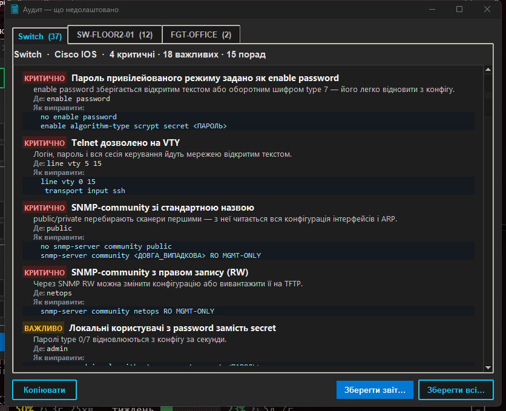

# network-documentr

Робить Word-документацію комутатора чи фаєрвола з його конфігурації. Даєш програмі `show running-config` (Cisco) або `show full-configuration` (FortiGate, FortiSwitch) — отримуєш DOCX з таблицями портів, VLAN та IP-адрес. Вендор визначається сам.

Кнопка **Аудит** показує, що на пристрої недолаштовано: telnet і відкритий SNMP, порти без режиму в VLAN 1, транки з усіма VLAN, адмінка на WAN тощо — з готовими командами для виправлення.


## Запуск

Завантаж `network-documentr.exe` з [Releases](https://github.com/kazapanama/network-documentr/releases/latest) — один файл, Python не потрібен.


1. **Завантажити конфігурації** — вибери один чи кілька файлів або перетягни їх на кнопку.
2. Перевір **модель** і **серійний номер**. Вони підтягуються самі, якщо у файлі є вивід `show inventory` / `show version` (Cisco) чи `get system status` (Fortinet); інакше впиши вручну або лиши порожніми.
3. **Створити DOCX**. Для одного файлу програма спитає, куди зберегти, для кількох — папку, і збереже кожен як `<hostname>_doc.docx`.
4. **Аудит** — окреме вікно з тим, що недолаштовано (див. нижче). Короткий підсумок видно одразу в рядку під назвою файлу.

Спробувати без свого обладнання: у [`examples/`](examples) лежать демо-конфіги Cisco і FortiGate, а `cisco-messy-switch.txt` — комутатор, на якому аудиту є що сказати.

## Аудит: що недолаштовано



Кожна знахідка — рівень (**КРИТИЧНО** / **ВАЖЛИВО** / **ПОРАДА**), що саме не так, чим це загрожує, де (порти стиснуті в діапазони: `Gi1/0/1-6, Gi1/0/9`) і як виправити — готові команди, для портів одразу `interface range`. Кілька конфігів — кілька вкладок. Звіт можна скопіювати або зберегти в DOCX (таблиця в стилі основного документа) чи TXT; «Зберегти всі…» пише `<hostname>_audit.docx` для кожного.

**Cisco IOS / IOS-XE**

| Що перевіряється | Приклади знахідок |
|---|---|
| Паролі | `enable password` замість `enable secret`, `username … password`, немає `service password-encryption` |
| Віддалений доступ | telnet або незадане `transport input` на VTY, немає `access-class`, `exec-timeout 0 0`, `login local` без користувачів, спільний пароль на лінії, немає `ip ssh version 2`, увімкнено `ip http server` |
| SNMP | community `public`/`private`, RW, без ACL |
| Службове | немає NTP, syslog, часових міток і часового поясу в логах, банера; стандартний hostname; `ip domain lookup`; L2-комутатор без `ip default-gateway`; класичний PVST; немає DHCP snooping; BPDU Guard без `errdisable recovery` |
| Порти | порожні й не вимкнені порти, порти без `switchport mode` (DTP), access у VLAN 1, без BPDU Guard / PortFast (з урахуванням глобальних `… default`), транки з усіма VLAN, native VLAN 1, не вимкнений DTP, port-security без самого `switchport port-security`, порти без опису, L3-порти без адреси не вимкнені |
| VLAN | порти посилаються на неоголошені VLAN, оголошені VLAN без жодного порту, керування у VLAN 1 |

**FortiGate / FortiSwitch**

| Що перевіряється | Приклади знахідок |
|---|---|
| Доступ до керування | `allowaccess` з http/telnet, https/ssh/snmp на WAN-інтерфейсі |
| Адміністратори | без trusted hosts, логін `admin`, без 2FA, `admintimeout` понад 15 хв, вимкнена політика паролів |
| Криптографія | `strong-crypto disable`, TLS 1.0/1.1 для адмінки |
| Службове | вимкнений NTP або custom без серверів, логи нікуди не відправляються, SNMP `public` або без обмеження hosts, стандартний hostname |
| Політики | accept «all → all ALL», accept без логування |
| FortiSwitch | `allowed-vlans-all`, вимкнений STP, native VLAN 1, порти без опису |

Аудит обережний: якщо у файлі немає потрібної секції (фрагмент конфігу замість `show full-configuration`, немає `line vty`), відповідні перевірки пропускаються, а не провалюються, — і про це написано вгорі звіту. Порожні `line vty` без `login`/AAA нікого не пускають і не перевіряються.

## Що потрапляє в документ

- **Шапка** — hostname, модель, серійний номер, MGMT IP, дата.
- **Фізичні порти** — опис, режим (access / trunk / routed), access чи native VLAN, дозволені VLAN на транку. У примітці: Voice VLAN, PortFast, RootGuard, BPDUGuard, Port Security, членство в Port-channel, shutdown (такі порти виділено кольором).
- **Port-channel та VLAN-інтерфейси** — режим та IP-адреса.
- **VLAN definitions** — якщо в конфігурації є `vlan N` з `name`.

Fortinet: FortiGate (`config system interface` — physical, vlan, aggregate, loopback, tunnel) і standalone FortiSwitch (`config switch physical-port|interface|trunk|vlan`).

**MGMT IP** береться так:
- Cisco — з `ip ssh source-interface`, інакше перший `ip address`;
- Fortinet — інтерфейс `mgmt` / `mgmt1` / `management`, інакше інтерфейс з `allowaccess` ssh/https, інакше перший IP.

Файл читається як UTF-8, CP1251 або Latin-1 — що підійде.

## Модель і серійний номер

Виконай додаткові команди в тій самій сесії терміналу й збережи весь вивід в один файл разом із конфігурацією.

**Cisco**

```
show running-config
show inventory          ← модель (PID) і серійний номер (SN)
show version            ← запасний варіант
```

Порядок пошуку: перший рядок `PID: … , SN: …` з `show inventory` (шасі або головний юніт стека) → `Model number` / `System serial number` з `show version` → `Processor board ID` (старі платформи, напр. 3750).

**Fortinet**

```
show full-configuration
get system status       ← серійний номер (рядок Serial-Number:)
```

Модель береться із заголовка конфігурації (`#config-version=FGT60E-7.2.5-…` → `FGT60E`), окрема команда не потрібна.

## З вихідного коду

Python 3.10+.

```bat
python -m venv .venv
.venv\Scripts\activate
pip install -r requirements.txt
python main.py
```

Тести (416 — парсери Cisco і Fortinet, DOCX-білдер і аудит):

```bat
pip install pytest
python -m pytest tests/
```

Збірка exe — `build.bat` (бере Python з `.venv`), результат у `dist\network-documentr.exe`. Прапорець `--collect-all=docx` обов'язковий: без нього exe не знайде шаблон `docx/templates/default.docx` і впаде при запуску.

## Інтерфейси Cisco

| Тип                  | Скорочення | Таблиця              |
|----------------------|------------|----------------------|
| GigabitEthernet      | Gi         | Фізичні порти        |
| FastEthernet         | Fa         | Фізичні порти        |
| TenGigabitEthernet   | Te         | Фізичні порти        |
| TwentyFiveGigE       | Twe        | Фізичні порти        |
| FortyGigabitEthernet | Fo         | Фізичні порти        |
| HundredGigE          | Hu         | Фізичні порти        |
| Management           | Mgmt       | Фізичні порти        |
| Port-channel         | Po         | Port-channel та VLAN |
| Vlan                 | Vlan       | Port-channel та VLAN |
| Loopback             | Lo         | Port-channel та VLAN |
