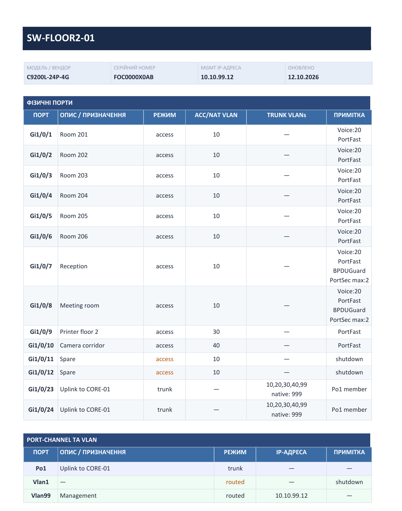
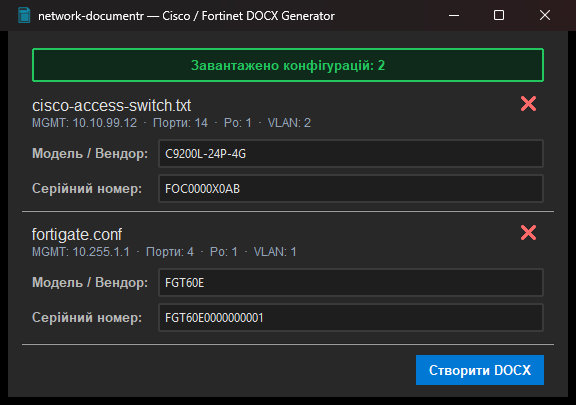

# network-documentr

Робить Word-документацію комутатора чи фаєрвола з його конфігурації. Даєш програмі `show running-config` (Cisco) або `show full-configuration` (FortiGate, FortiSwitch) — отримуєш DOCX з таблицями портів, VLAN та IP-адрес. Вендор визначається сам.



## Запуск

Завантаж `network-documentr.exe` з [Releases](https://github.com/kazapanama/network-documentr/releases/latest) — один файл, Python не потрібен.



1. **Завантажити конфігурації** — вибери один чи кілька файлів або перетягни їх на кнопку.
2. Перевір **модель** і **серійний номер**. Вони підтягуються самі, якщо у файлі є вивід `show inventory` / `show version` (Cisco) чи `get system status` (Fortinet); інакше впиши вручну або лиши порожніми.
3. **Створити DOCX**. Для одного файлу програма спитає, куди зберегти, для кількох — папку, і збереже кожен як `<hostname>_doc.docx`.

Спробувати без свого обладнання: у [`examples/`](examples) лежать демо-конфіги Cisco і FortiGate.

## Що потрапляє в документ

- **Шапка** — hostname, модель, серійний номер, MGMT IP, дата.
- **Фізичні порти** — опис, режим (access / trunk / routed), access чи native VLAN, дозволені VLAN на транку. У примітці: Voice VLAN, PortFast, RootGuard, BPDUGuard, Port Security, членство в Port-channel, shutdown (такі порти виділено кольором).
- **Port-channel та VLAN-інтерфейси** — режим та IP-адреса.
- **VLAN definitions** — якщо в конфігурації є `vlan N` з `name`.

Fortinet: FortiGate (`config system interface` — physical, vlan, aggregate, loopback, tunnel) і standalone FortiSwitch (`config switch physical-port|interface|trunk|vlan`).

**MGMT IP** береться так:
- Cisco — з `ip ssh source-interface`, інакше перший `ip address`;
- Fortinet — інтерфейс `mgmt` / `mgmt1` / `management`, інакше інтерфейс з `allowaccess` ssh/https, інакше перший IP.

Файл читається як UTF-8, CP1251 або Latin-1 — що підійде.

## Модель і серійний номер

Виконай додаткові команди в тій самій сесії терміналу й збережи весь вивід в один файл разом із конфігурацією.

**Cisco**

```
show running-config
show inventory          ← модель (PID) і серійний номер (SN)
show version            ← запасний варіант
```

Порядок пошуку: перший рядок `PID: … , SN: …` з `show inventory` (шасі або головний юніт стека) → `Model number` / `System serial number` з `show version` → `Processor board ID` (старі платформи, напр. 3750).

**Fortinet**

```
show full-configuration
get system status       ← серійний номер (рядок Serial-Number:)
```

Модель береться із заголовка конфігурації (`#config-version=FGT60E-7.2.5-…` → `FGT60E`), окрема команда не потрібна.

## З вихідного коду

Python 3.10+.

```bat
python -m venv .venv
.venv\Scripts\activate
pip install -r requirements.txt
python main.py
```

Тести (364 — парсери Cisco і Fortinet та DOCX-білдер):

```bat
pip install pytest
python -m pytest tests/
```

Збірка exe — `build.bat` (бере Python з `.venv`), результат у `dist\network-documentr.exe`. Прапорець `--collect-all=docx` обов'язковий: без нього exe не знайде шаблон `docx/templates/default.docx` і впаде при запуску.

## Інтерфейси Cisco

| Тип                  | Скорочення | Таблиця              |
|----------------------|------------|----------------------|
| GigabitEthernet      | Gi         | Фізичні порти        |
| FastEthernet         | Fa         | Фізичні порти        |
| TenGigabitEthernet   | Te         | Фізичні порти        |
| TwentyFiveGigE       | Twe        | Фізичні порти        |
| FortyGigabitEthernet | Fo         | Фізичні порти        |
| HundredGigE          | Hu         | Фізичні порти        |
| Management           | Mgmt       | Фізичні порти        |
| Port-channel         | Po         | Port-channel та VLAN |
| Vlan                 | Vlan       | Port-channel та VLAN |
| Loopback             | Lo         | Port-channel та VLAN |
